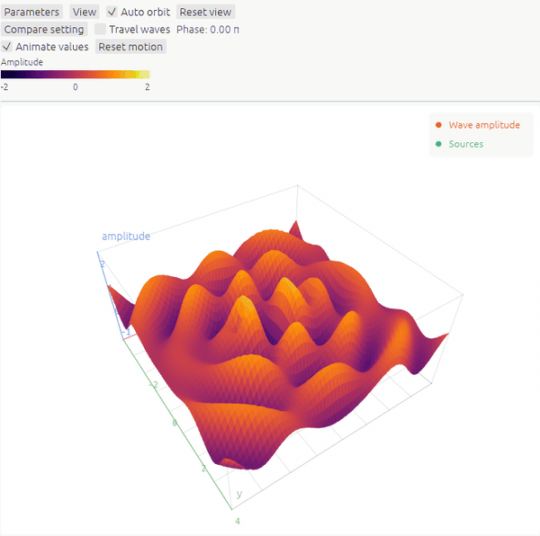

# egui_plot3d

Immediate mode 3D plotting library for [`egui`](https://github.com/emilk/egui), with an API inspired by [`egui_plot`](https://github.com/emilk/egui_plot).

[API examples](src/lib.rs) · [Gallery source](demo/src)

Not yet published to crates.io. Use a local path or Git dependency.

## Testing

- Locally: `cargo run --release -p egui_plot3d_demo`
- Web: `cd demo` then `trunk serve --release`
- Tests: `cargo test --workspace`
- Documentation: `cargo doc --no-deps --open`

The web demo requires [Trunk](https://trunkrs.dev/) and the `wasm32-unknown-unknown` Rust target.

## Plotting libraries in Rust

See egui_plot's [notes on the Rust plotting ecosystem](https://github.com/emilk/egui_plot/blob/main/ECOSYSTEM.md).

## Contributing

[Issues](https://github.com/boquila/egui_plot3d/issues) and [pull requests](https://github.com/boquila/egui_plot3d/pulls) are welcome.
